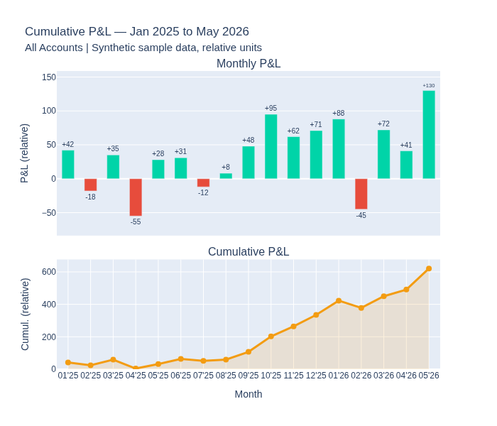
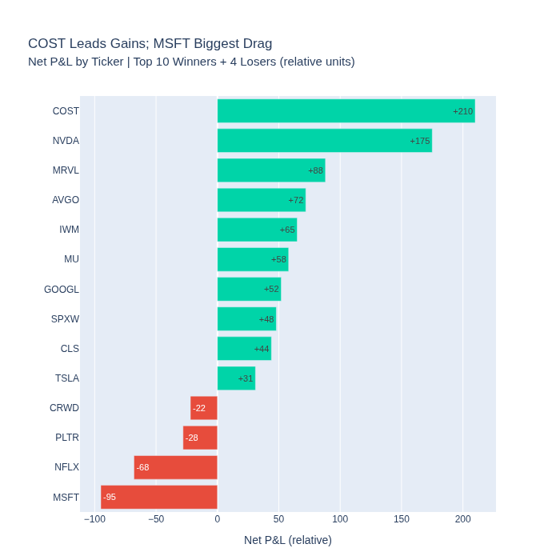
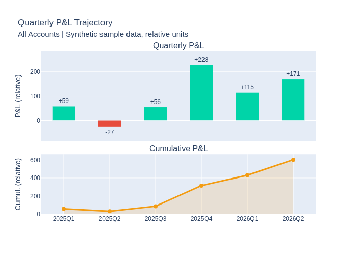
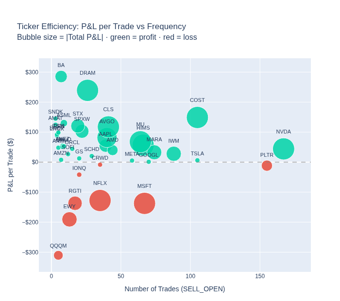
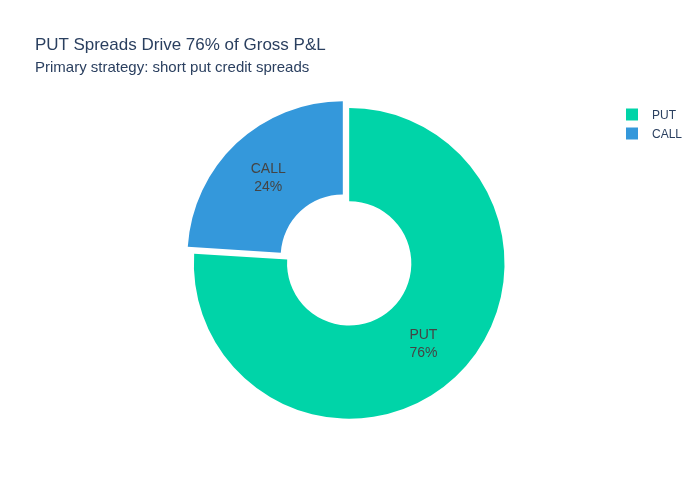

# Options Trading Analysis (Jan 2025 – Sep 2026)

**English** | [한국어](README.ko.md)

## Overview
This folder contains the analysis pipeline and insights derived from personal, manually traded options transaction data (January 2025 – September 2026, 21 months) across four brokerage accounts (Account A, B, C, D).

---

## Folder Structure

```
options-analysis/
├── data/
│   ├── Accounts_History*.csv    # Raw Fidelity export files (add manually, do NOT commit)
│   ├── options_cleaned.csv      # Auto-generated by analysis.py
│   └── realized_pnl.csv         # Auto-generated: one row per FIFO-matched close
├── charts/                      # PNG charts (9 total) — sample set committed
├── analysis.py                  # Full pipeline: load → clean → analyze → visualize
├── generate_sample_charts.py    # Generates charts/ from synthetic data (for display)
├── insights_report.md           # Key findings & action plan
└── README.md
```

---

## Key Stats (Jan 2025 – Sep 2026)

All figures are **realized P&L**: each close is matched to its opening trade
(FIFO, per account and contract) and booked when the position closed.

| Metric | Value |
|---|---|
| Realized P&L by year | **Profitable in both years** (2025, and 2026 through September) |
| Year-over-year | 2026 through September is already **~4x** full-year 2025 |
| Recent quarters | **2026 Q2 and Q3** are the two strongest quarters on record |
| Primary Strategy | Put Credit Spreads |
| Accounts | 4 (Individual + IRA types) |
| Period | Jan 2025 – Sep 2026 |

**Why realized P&L, not cash flow.** Summing premium in and out by
transaction date gives net cash flow, which is not P&L: a credit spread pays
its premium up front, so months with many new positions look profitable
before their outcome is known, and cash flow and realized P&L can point in
opposite directions in the same month. (Earlier versions of this README quoted
a cash-flow-basis win rate.)

> Specific P&L figures are maintained in a private repository.

---

## How to Run

```bash
# 1. Install dependencies
pip install pandas plotly kaleido

# 2. Copy Fidelity CSV exports into data/
cp ~/Downloads/Accounts_History*.csv data/

# 3. Run full pipeline
python analysis.py
# → Prints realized P&L (FIFO) next to net cash flow, and checks that
#   realized + still-open premium + pre-window closes == cash flow
# → Saves data/options_cleaned.csv and data/realized_pnl.csv
# → Saves 9 charts to charts/ (P&L charts use realized P&L)
```

**Overlapping exports are safe to combine.** Rows repeated across exports with
overlapping date ranges are counted once, but identical rows *within* one export
are kept: a split fill (same contract, price and day) shows up as identical rows
and is a real trade, so a blanket de-duplication would silently drop it.

---

## Sample Charts

> Charts below are generated from synthetic data in relative units, for illustration only —
> their shape does not reproduce actual results (see [`insights_report.md`](insights_report.md)
> for the realized-basis review). Actual P&L figures are in a private repository.
> To generate from your own data, run `python analysis.py` after adding CSV exports to `data/`.

### Monthly P&L + Cumulative Growth


### Net P&L by Ticker


### Quarterly Trajectory


### Ticker Efficiency (P&L per Trade vs Frequency)


### Strategy Split — PUT vs CALL


<details>
<summary>All 9 charts</summary>

| File | Description |
|---|---|
| `chart1_monthly_pnl.png` | Monthly P&L bars + cumulative growth line |
| `chart2_ticker_pnl.png` | Net P&L by ticker (top winners + losers) |
| `chart3_put_vs_call.png` | PUT vs CALL strategy P&L split |
| `chart4_trade_count.png` | Monthly trade frequency trend |
| `chart5_account_pnl.png` | Net P&L by account type |
| `chart6_weekday_pnl.png` | P&L by day of week |
| `chart7_ticker_frequency.png` | New positions opened by ticker |
| `chart8_quarterly_pnl.png` | Quarterly P&L bars + cumulative growth line |
| `chart9_ticker_efficiency.png` | P&L per trade vs trade frequency scatter |

</details>
